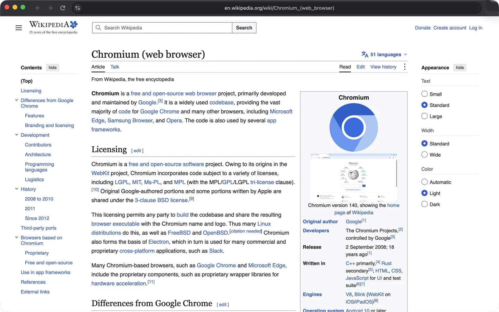
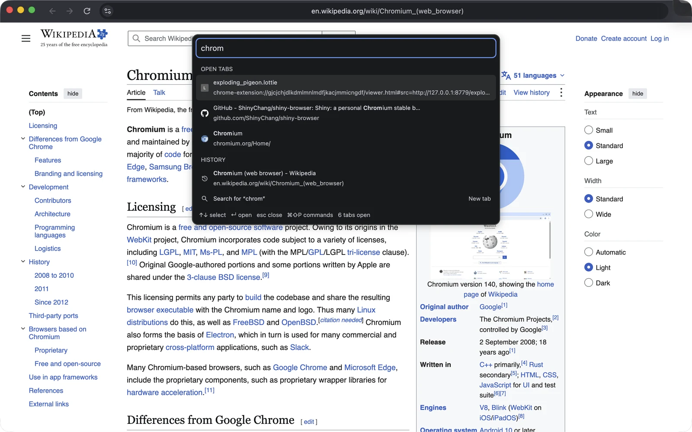
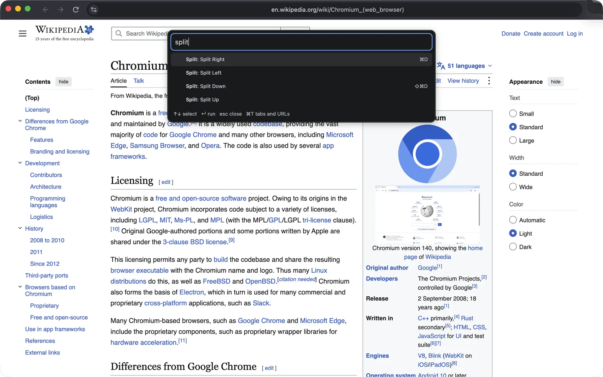
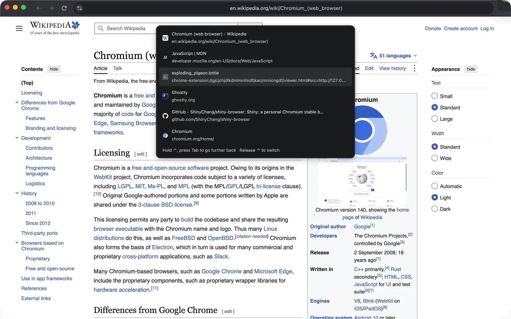
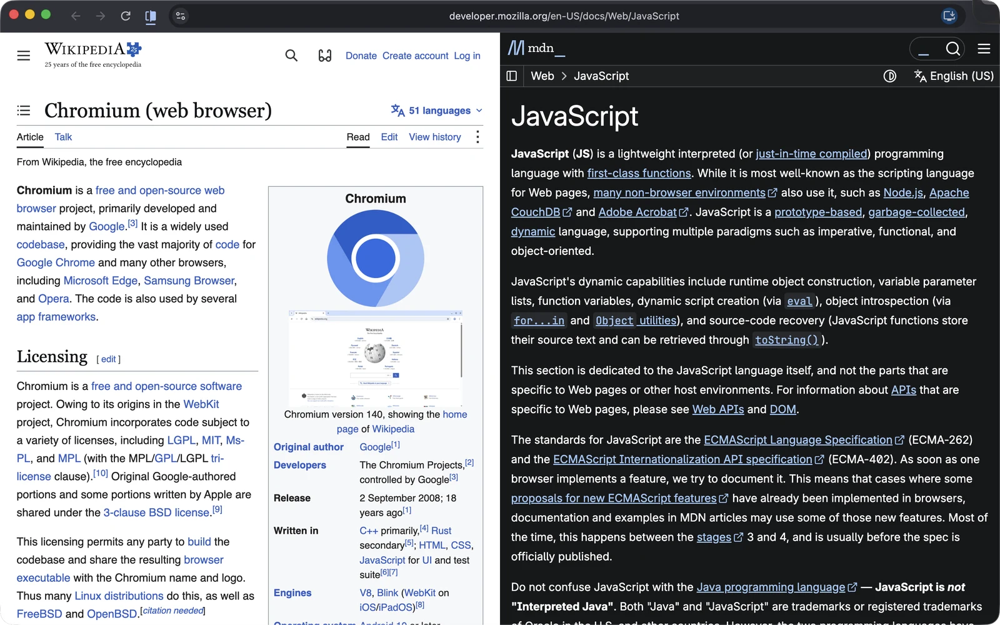
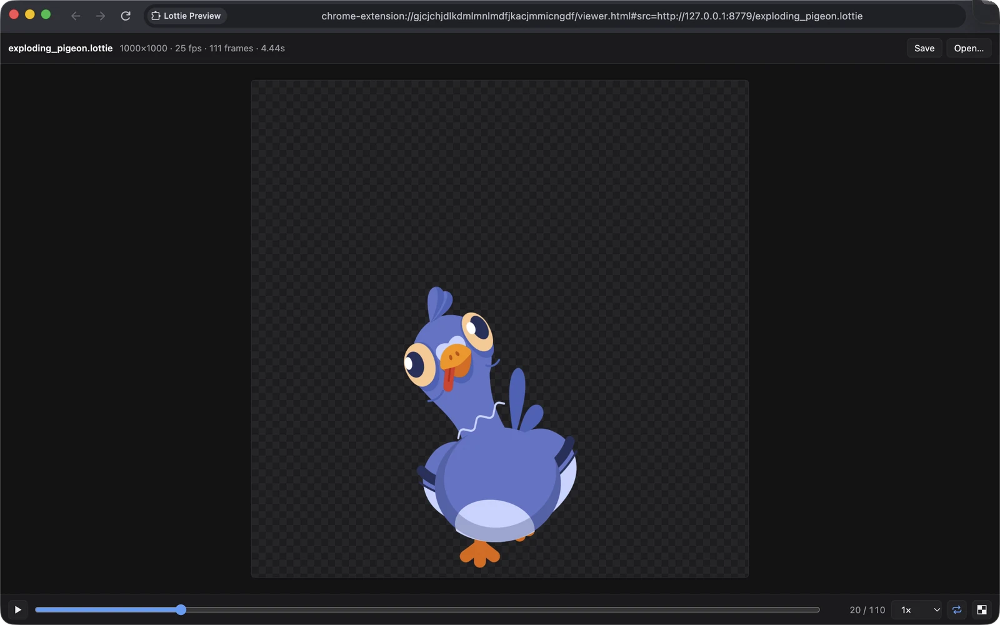

# shy-browser

Shy is a personal browser built from Chromium stable for macOS: one toolbar, no tab strip,
everything a keystroke away.

https://github.com/user-attachments/assets/97099246-e78c-4017-a90f-abc30c6af8ba

## Features

### Go to Anything (Cmd+T)

Open tabs, history and recently closed tabs in one fuzzy-matched list. Anything else opens as a
URL or a search. Beside the list, a preview shows the selected entry, with a picture of the page
when it is an open tab.

### Command palette (Shift+Cmd+P)

Browser commands by name, each with its shortcut.

### Ctrl+Tab in most-recently-used order

Tap Ctrl+Tab to flip between the last two tabs; hold Ctrl and keep pressing Tab to go further back.

### Split view with Ghostty's keys

| Keys | Action |
| --- | --- |
| Cmd+D / Shift+Cmd+D | Split right / split down |
| Cmd+Opt+arrows | Select the pane in that direction; with none, Left and Right switch to the previous or next tab |
| Cmd+Ctrl+arrows, Cmd+Ctrl+= | Move the divider, even it out |
| Cmd+W | Close the active pane |

Panes are drawn edge to edge, with no frame or gap between them. Cmd+T opens tabs, URLs and
history in the active pane.

### Lottie preview

Lottie JSON and .lottie files open in a built-in player: play and pause, frame-by-frame
scrubbing, speed, loop, backgrounds, and the themes and animations inside a .lottie. Its source
is in [lottie-preview/](lottie-preview), built on
[dotlottie-web](https://github.com/LottieFiles/dotlottie-web).

### Ready for agents

Shy starts its remote debugging server at launch, in the approval mode of
`chrome://inspect/#remote-debugging`: it writes the port to `DevToolsActivePort` in the profile
directory, and every connection waits until you click Allow. Any app on the Mac can ask, so allow
only connections you started. The same page turns the server off.

[WebMCP](https://github.com/webmachinelearning/webmcp) is on, so pages can register tools with
`document.modelContext` for agents to call. To let
[chrome-devtools-mcp](https://github.com/ChromeDevTools/chrome-devtools-mcp) drive the running
browser and its WebMCP tools:

    npx chrome-devtools-mcp@latest --autoConnect --categoryExperimentalWebmcp=true \
      --userDataDir "$HOME/Library/Application Support/Chromium IDE"

### Talk to Shy

[talk-to-shy/](talk-to-shy) lets an agent on another machine, such as a chat bot, work with the
tabs you have open. Its MCP tools read (`list_tabs` across windows, `read_page` as text or as an
accessibility tree with a ref for each element, `screenshot`), open and close tabs of their own
(`open_tab` works in the background, `close_tab`), drive with real input (`click`, `type_text`,
`press_key`, `scroll`, `navigate`; an element is a ref, a CSS selector or a point), run scripts
(`run_script`), read the debugger's network log (`network_requests`, including requests that failed
before any response, and `network_request` for headers and body, with credentials hidden), use a
page's WebMCP tools (`list_webmcp_tools`, `call_webmcp_tool`) and run several of these in one call
(`batch`, which stops at the first failure). With "Use and drive any site without
asking" on, the default, all of them work on any site without a prompt. Turn it off and a site you
have not listed waits until you allow it, and so does each kind of action on a site (driving,
scripts, a WebMCP tool that changes the page): the side panel shows the request, the toolbar
button counts the ones waiting, and the panel lists every call. While the agent works, a line under
the chat says what it is doing (thinking, the command it runs, the browser tool it uses), and the
tools a reply used fold up under it instead of sitting in the text. Shift+Cmd+S opens and closes
the panel; `chrome://extensions/shortcuts` changes the key.

An extension cannot accept connections, so [agent-relay/](agent-relay) sits in between: agents
speak MCP over HTTP to `/mcp`, and the extension keeps a WebSocket open to `/extension`. Both
present the token in `~/.config/shy/token`.

    cd agent-relay && npm ci && node server.mjs

The relay listens on 127.0.0.1:8796. To reach Shy wherever it is, publish `/extension`, for
example with a Cloudflare Tunnel whose ingress rule has `path: ^/extension$`. Keep `/mcp` local,
or, for agents on other machines, publish it under a hostname of its own behind Cloudflare Access
with a Service Auth policy, so that only requests carrying the service token's
`CF-Access-Client-Id` and `CF-Access-Client-Secret` reach the relay's own token check. Then load
`talk-to-shy/` from `chrome://extensions` with Developer mode on, open its side panel and enter
the relay's address and the token. It reconnects within seconds when the relay or the tunnel
restarts.

With `SLACK_CHANNEL` and `SLACK_AGENT` (the agent's Slack user id) set, the chat goes through
Slack: each panel conversation is a thread in that channel, posted with the token in
`SLACK_TOKEN_FILE` (default `~/.config/shy/slack-user-token`), and replies typed in Slack show up
in the panel. A user token posts as you; a bot token posts as that bot, so one bot such as "Shy"
can speak for several people. Either needs `chat:write`, `channels:history`, `groups:history`,
`files:read` and `files:write`, and a bot has to be invited to the channel. Every message
mentions the agent, because Slack marks API posts with the app's bot id and agents that ignore
other bots' unmentioned messages would skip them.

One relay serves one browser, one channel and one agent. For another person, run a second relay
with its own `PORT`, `TOKEN_FILE`, `SLACK_CHANNEL`, `SLACK_AGENT` and `SLACK_THREADS_FILE`, and
publish its `/extension` under its own hostname.

### Also

- The last session reopens on launch.
- Background tabs left idle for 12 hours close themselves; pinned tabs stay.
- H.264 and AAC playback.

## Build

- A link button in the location bar, shown while the pointer is over it, copies the address; a
  click on the address edits it.
Shy is Chromium stable at the version in [CHROMIUM_VERSION](CHROMIUM_VERSION) plus the commits
in [patches/](patches), one per feature, compiled with [args.gn](args.gn). On a Mac with Xcode
and 45 GB free:

    git clone https://github.com/ShinyChang/shy-browser
    shy-browser/scripts/build.sh ~/shy-chromium

The script fetches Chromium without its history, applies the patches and builds
`~/shy-chromium/src/out/Release/Shy.app`. On an M1 Max with `JOBS=8` the fetch took 12
minutes and the compile 2 hours 40 minutes. Running it again resumes an interrupted fetch or
build.

The build is ad-hoc signed, so macOS may ask again for keychain access or camera and microphone
permission after an update. `scripts/sign.sh Shy.app IDENTITY` signs it with your own
code-signing identity instead.

## Updates

A daily GitHub Actions job compares Chrome stable for Mac with `CHROMIUM_VERSION` and opens a
`chrome-update` issue when a newer version ships. On the build Mac, launchd runs
`scripts/auto-build.sh` every four hours: it makes the same check, builds a new version in a work
directory of its own, runs the `AFTER_BUILD` command on it and, when gh is logged in, comments the
result on the issue. On the build Mac that command runs the Lottie tests and then publishes the
build as an update (below), so installed copies offer it within hours. Once that build is
installed, `scripts/export-patches.sh` writes the rebased commits back to `patches/`,
`lottie-preview/` and `CHROMIUM_VERSION`, and the issue is closed with that commit.

`scripts/publish-update.sh Shy.app UPDATES_DIR` turns a build into a
[Sparkle](https://sparkle-project.org) update: it adds Sparkle, signs the app and writes the
archive and `appcast.xml` for any web server to serve. A copy installed from such an archive
checks the feed every four hours and offers to install newer builds; its About page says whether
one is available. A build that was not published this way never checks for updates.

Pages in the screenshots: [Wikipedia](https://en.wikipedia.org/wiki/Chromium_(web_browser))
(CC BY-SA 4.0) and [MDN Web Docs](https://developer.mozilla.org/en-US/docs/Web/JavaScript)
(CC BY-SA 2.5).

Unofficial; not affiliated with Google or the Chromium project.
